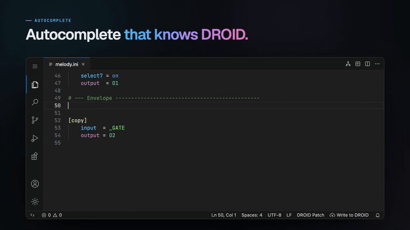
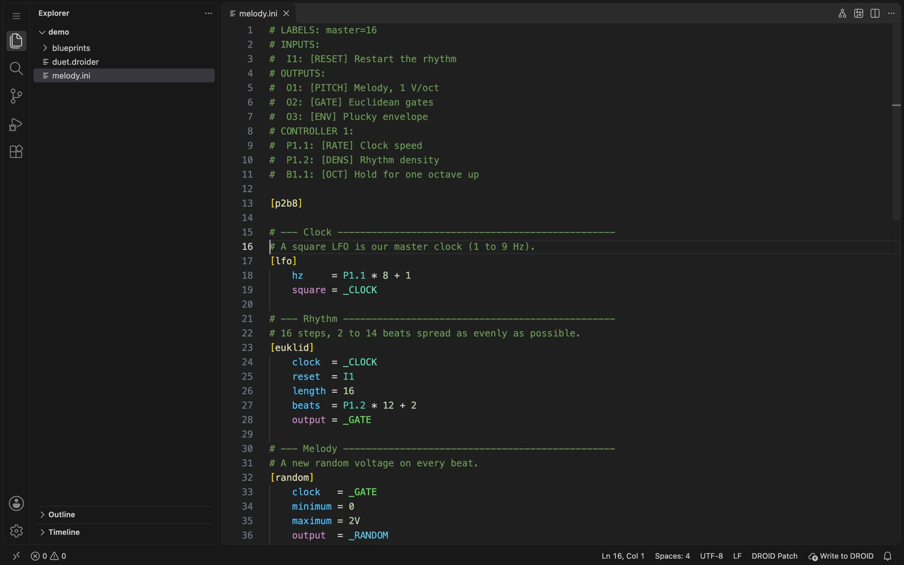

<p align="center">
  <a href="https://oliverlsanz.com/droider/"></a>
</p>

<h1 align="center">Droider</h1>

<p align="center">
  <b>DROID patches without the guesswork.</b><br>
  A free VS Code extension for DROID Eurorack patches: live error checking,
  autocompletion, hover docs, rainbow cables, hardware and circuit-graph views, megacircuits and one-click SD-card upload.
</p>

<p align="center">
  <a href="https://oliverlsanz.com/droider/"></a>
</p>

<p align="center">
  <a href="https://marketplace.visualstudio.com/items?itemName=oliverlsanz.droider"></a>
  <a href="https://oliverlsanz.com/droider/docs/"></a>
  <a href="https://github.com/OliverLSanz/droider/releases/latest"></a>
</p>

<p align="center">
  <a href="https://oliverlsanz.com/droider/#tour"></a><br>
  <a href="https://oliverlsanz.com/droider/#tour"><b>▶ Watch the one-minute tour</b></a>
</p>

## Features

- **Live error checking.** The checks the DROID master runs when it loads a patch, run as you type: unknown circuits,
  parameters and registers, cables with no source or no reader, outputs written twice, inputs used as outputs,
  `A * B + C` violations and lines over 63 characters.
- **Autocompletion.** Circuits after `[`, each circuit's parameters, the registers your declared hardware has, and the
  cables already in the patch.
- **Docs on hover.** Every circuit, parameter and register, with type, default, range and description, from the
  official manual.
- **Colours that mean something.** Inputs and outputs in different colours, and a unique colour per internal cable.
- **Forge label legends.** Validated and autocompleted, and shown in the views.
- **Hardware view.** Your master, expanders and controllers drawn with your labels.
- **Circuit graph.** The patch as an interactive signal-flow graph. Click a node to jump to its line.
- **Write to DROID.** Insert the SD card and click the status-bar button: the patch is checked, written, verified and
  the card ejected safely. Works on macOS, Windows and Linux.
- **`.droider` patches.** Reusable **megacircuits** (`.blueprint` files) and **free arithmetic** on any input,
  compiled into a plain `droid.ini`.

Free, open source, works offline, no account.

<p align="center">
  
</p>

## Install

1. Install [VS Code](https://code.visualstudio.com/download) (free, Windows, macOS and Linux).
2. Open the **Extensions** view (<kbd>Ctrl</kbd>+<kbd>Shift</kbd>+<kbd>X</kbd>, or <kbd>⌘</kbd>+<kbd>⇧</kbd>+<kbd>X</kbd>
   on a Mac), search for **Droider** and click **Install**.
3. Open the folder with your patches (**File → Open Folder…**). Droider handles every `.ini`, `.droider` and
   `.blueprint` file.

New to VS Code? The [guide](https://oliverlsanz.com/droider/docs/) walks you through every step, from installing VS Code to
writing your first patch. For Cursor, VSCodium and other VS Code-based editors, install the `.vsix` from the
[latest release](https://github.com/OliverLSanz/droider/releases/latest) with **Install from VSIX…**.

## A taste of `.droider`

A megacircuit is your own reusable circuit: define it once in a `.blueprint` file, then use it in any `.droider`
patch like a built-in circuit.

```ini
# blueprints/randomnote.blueprint
# A megacircuit is your own reusable circuit.
# This file defines [randomnote]: a random note in C minor on every clock.
[input]
    clock
    range = 2V         # inputs with a default are optional
[output]
    pitch

[random]
    clock   = clock
    maximum = range
    output  = _VOLTAGE # private: each copy gets its own cable

[minifonion]
    input   = _VOLTAGE
    degree  = 7        # natural minor
    select1 = on
    select3 = on
    select5 = on
    output  = pitch
```

```ini
# melodies.droider: use your megacircuit like any other circuit
[randomnote]
    clock = _RHYTHM
    pitch = O1

[randomnote]
    clock = _CLOCK
    range = 1V
    pitch = O2

[copy]  # any arithmetic, not just A * B + C: pot 1 morphs between the melodies
    input  = (O1 - O2) * P1.1 + O2
    output = O3
```

Droider expands megacircuits, splits the arithmetic into native `[copy]` circuits and checks the resulting plain `.ini`
before it goes to the card. The complete examples are in [`examples/`](examples/).

## Documentation

- [Guide](https://oliverlsanz.com/droider/docs/): step by step, organised by what you want to do.
- [Language reference](docs/reference.md): the DROID patch language as Droider understands it.
- [Development](docs/development.md): build from source, architecture, tests, the command-line linter and releases.

Found a bug or have an idea? [Open an issue](https://github.com/OliverLSanz/droider/issues).

---

Made by [Óliver L. Sanz](https://oliverlsanz.com/). Code under the [MIT license](LICENSE). DROID is made by
Der Mann mit der Maschine; Droider is not affiliated with it. The circuit documentation is adapted from the official
DROID manual with the author's written permission and is not covered by the MIT license.
